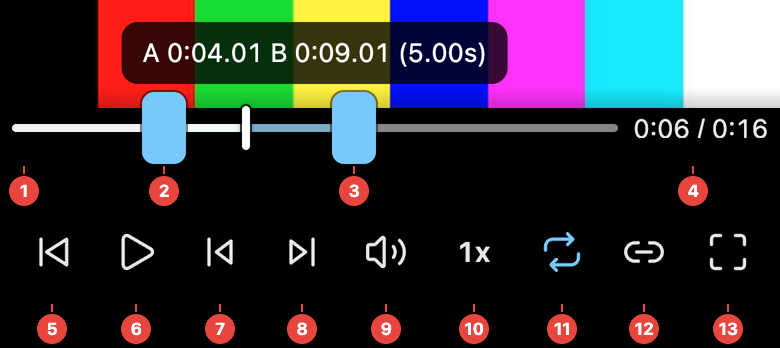
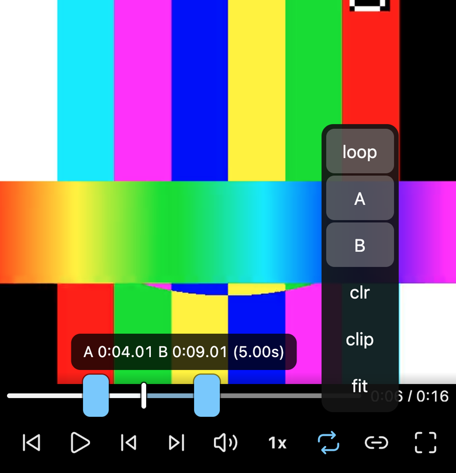
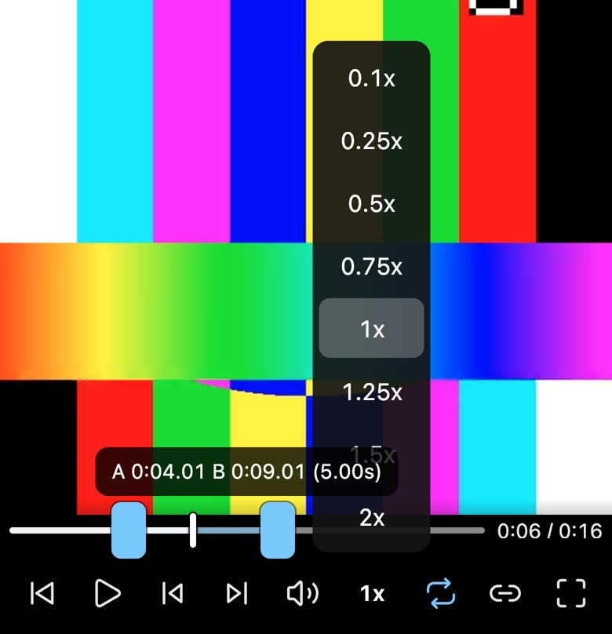

# Socials Video Controls

Frame-accurate video controls for Instagram and Facebook, built for learning
dance: bracket a move, loop it, slow it down, step through it one frame at a
time. Works on desktop as an extension and on iPhone or iPad as a userscript.

> **Fork notice.** This began as [Instagram Video Control](https://git.skp.my.id/surya/instagram-video-control)
> by Surya Kencana Putra, MIT licensed, and keeps that licence and copyright
> notice. It has since diverged substantially: frame stepping, jog scrubbing,
> drag scrubbing, A–B loop practice, clip export, theater mode, touch support, a
> test suite and Facebook support were added here. It is unrelated to the
> similarly named [Arcus92/instagram-video-control](https://github.com/Arcus92/instagram-video-control).

[](manifest.json)
[](LICENSE)
[-success)](ARCHITECTURE.md)

<p align="center">
  
</p>

---

## What it does

- **A–B loop practice.** Bracket a few seconds and loop them until you have the
  move. Markers are soft: set them roughly, then refine.
- **Frame-by-frame stepping**, with the frame rate measured off the video rather
  than guessed, so steps do not drift or repeat.
- **Smooth jog scrubbing** on a held key or a held button, and live drag
  scrubbing where the picture follows your finger or pointer instead of waiting
  for release.
- **Speed from 0.1× to 2×**, which applies to loops too.
- **A real seek timeline** with a buffered-range indicator, on sites that ship
  almost no controls.
- **Shareable loop links** — a URL that reopens the video on the move.
- **Clip export** of the marked segment.
- **Theater mode** that fills the screen without hiding the browser.
- **Persistent volume and speed** across videos and sessions.

It makes **no network requests of any kind**. See [PRIVACY.md](PRIVACY.md).

---

## Pick your platform

The two platforms get the same engine but a deliberately different interface,
because touch has no hover to reveal a bar and no keyboard to step frames.

| | [**Mobile**](#mobile) | [**Desktop**](#desktop) |
| :--- | :--- | :--- |
| You install | A userscript, via a userscript manager | An unpacked extension |
| Bar appears | On tap, and whenever paused | On hover |
| Stepping one frame | `◀∣` / `∣▶` buttons on the bar | `←` / `→` arrow keys |
| Setting a loop | Long-press the track and drag | `[` and `]` keys |
| Volume | Mute only | Mute button with a volume slider |
| Clip export | Not on iOS; offered where supported | Yes |
| Keyboard shortcuts | — | Full set |

---

# Mobile

## Install on iPhone or iPad

iOS cannot load an unpacked extension, so the same code ships as a single
userscript.

1. Install a userscript manager from the App Store —
   [Userscripts](https://apps.apple.com/us/app/userscripts/id1463298887) is free
   and open source. Tampermonkey and Stay also work.
2. Open the app and point it at a folder.
3. Open this link on the device and the manager will offer to install it:

   ```
   https://raw.githubusercontent.com/nhuisman/socials-video-controls/main/dist/socials-video-controls.user.js
   ```

   Or copy `dist/socials-video-controls.user.js` into that folder by hand.
4. In **Settings → Apps → Safari → Extensions**, enable the manager and allow it
   on `instagram.com` and `facebook.com`.

Re-open the same link after an update to upgrade.

## Install on Android

Chrome and most Chromium browsers on Android have no extension support at all,
so the route is a userscript manager in a browser that does. **Firefox for
Android with Tampermonkey** is the straightforward one — install Tampermonkey
from addons.mozilla.org, then open the `.user.js` link above. Brave for Android
has extension support behind `brave://flags/#brave-android-extensions`, but the
first phase targets tablets.

Clip export is not ruled out on Android the way it is on iOS. The `clip` button
hides itself only when the browser has no `HTMLMediaElement.captureStream`,
which is an iOS/WebKit limitation rather than a mobile one — so on Android the
button appears if the engine supports it.

> Untested by me. The userscript carries no platform-specific code and decides
> what to offer by feature detection, so it should behave sensibly, but treat
> that as a reasonable expectation rather than a verified claim.

## The controls

Tap the video to show the bar. It hides again while playing, and stays up
whenever the video is paused, a menu is open, or you are dragging.

<p align="center">
  
</p>

| # | Control | What it does |
| :--- | :--- | :--- |
| 1 | Seek track | Drag to scrub — the picture follows your finger. Carries the loop span, both handles, the playhead and the buffered range. Long-press to paint a loop. |
| 2 | Loop start, **A** | Drag to move the start of the loop. The frame you are setting is shown as you drag. |
| 3 | Loop end, **B** | Drag to move the end of the loop. |
| 4 | Readout | Position and duration. Gains decimals while you are stepping frames. |
| 5 | Jump to A | Snaps back to the loop start. Leftmost because it is the one you press most while practising. |
| 6 | Play / pause | |
| 7 | Step back | Tap for exactly one frame back, hold to jog scrub. Mobile only — this is the `←` key's job on desktop. |
| 8 | Step forward | Tap for one frame forward, hold to jog scrub. |
| 9 | Mute | Mute only. iOS will not let a page set the volume, so there is no slider. |
| 10 | Speed | Opens the speed menu. |
| 11 | Loop | Opens the loop menu. |
| 12 | Link | Copies a URL that reopens the video at this loop, at this speed. Appears once both A and B are set. |
| 13 | Fullscreen | Real fullscreen. Theater mode — which covers the page but keeps the browser visible — is on `t` on desktop. |

Controls 5 and 7 use a similar icon: the first is *jump to the loop start*, the
third is *back one frame*.

### The two menus

Tap the speed button or the loop button to open its menu; tap again to close.

<p align="center">
  
  &nbsp;&nbsp;
  
</p>

| Loop menu | |
| :--- | :--- |
| `loop` | Start and stop looping. Mobile only — on desktop the bar's loop button toggles directly. |
| `A` | Set the loop start at the current frame |
| `B` | Set the loop end at the current frame |
| `clr` | Clear both markers |
| `clip` | Export the marked segment as a file. Hidden on iOS, which has no `captureStream` to record from. |
| `fit` / `full` | Zoom the timeline around a tight loop, or back out to the whole video |

The speed menu runs `0.1×`, `0.25×`, `0.5×`, `0.75×`, `1×`, `1.25×`, `1.5×`,
`2×`, and applies to loops as well as normal playback.

## Creating a loop on mobile

1. **Long-press the seek track** where the move starts. A lands under your
   finger and the timeline zooms in around it.
2. **Drag to where the move ends and lift.** That sets B, and looping starts
   immediately — marking the end of a move is when you want to begin practising
   it.
3. **Refine with `◀∣` and `∣▶`.** Step to the exact frame, then open the loop
   menu and tap `A` or `B` to move that marker to where you are. Or drag the
   handles directly; the picture follows the handle, so you can see the frame
   you are setting.
4. **Slow it down** with the speed button. A quarter speed is the point of the
   whole feature.
5. **Jump to A** (control 5) restarts the loop; `loop` in the menu stops and
   starts it; `clr` clears both markers.
6. **Link** (control 12) copies a URL that reopens the video on this loop — for
   sending someone a specific eight bars.

A loop under three frames is refused, because it thrashes the decoder and shows
nothing useful. The timeline zooms in automatically when the handles get too
close together to aim at.

> **About these screenshots.** They are captured from Chromium driven with
> iPhone viewport metrics and touch emulation, against a synthetic test video —
> not from real Safari, and not from a real Instagram post. The repository is
> public, so shooting a logged-in session would publish account state and
> someone else's video. The layout, sizes and controls are the real touch mode;
> the colour bars are a test pattern.

---

# Desktop

## Install

Chrome, Edge, Brave, Opera, or any Chromium browser:

1. Clone the repository:
   ```bash
   git clone https://github.com/nhuisman/socials-video-controls.git
   ```
2. Open `chrome://extensions` (or `edge://extensions`).
3. Turn on **Developer mode**.
4. Click **Load unpacked** and pick the cloned folder.
5. Open a video post or Reel.

## The controls

The bar appears at the bottom of the player when you hover it.

| Control | What it does |
| :--- | :--- |
| Jump to A | Snaps back to the loop start. Leftmost, because it is the one you press most while practising. |
| Play / pause | Also `Space`. |
| Readout | Position and duration, gaining decimals while you step frames. |
| Seek track | Drag to scrub. Carries the loop span, both handles, the playhead and the buffered range. |
| Mute | Hover for a volume slider. |
| Speed | `0.1×` to `2×`. Applies to loops as well. |
| Loop | **Click toggles looping. Right-click clears both markers.** Hover opens the menu: `A`, `B`, `clr`, `clip` and the `fit` timeline zoom. |
| Link | Copies a URL that reopens the video at this loop, at this speed. Appears once A and B are set. |
| Fullscreen | Real fullscreen on click. **Right-click, or `t`, for theater mode** — fills the screen but keeps the browser's tabs and address bar visible. |

Desktop has no frame-step buttons: the arrow keys do that job and do it better,
with tap-to-step and hold-to-scrub on the same key.

## Keyboard shortcuts

| Key | Action |
| :--- | :--- |
| `←` / `→` tap | Step back / forward exactly one frame |
| `Shift` + tap | Step 10 frames |
| `←` / `→` hold | Smooth jog scrub at half speed |
| `Shift` + hold | Smooth jog scrub at double speed |
| `Space` | Play / pause |
| `t` | Theater mode |
| `[` | Set loop start (A) at the current frame |
| `]` | Set loop end (B) at the current frame |
| `\` | Toggle looping |
| `Home` | Jump back to A |
| `\|` | Clear both markers |

The shortcuts only apply to the player whose control bar is showing, so
Instagram's own arrow-key and `Space` handling is untouched everywhere else.
They are ignored while focus is in a text field, and `Ctrl`, `Cmd` or `Alt`
combinations pass through to the browser.

**Keyboard navigation is silent.** The first keyboard move mutes the video and
it stays muted until you deliberately resume playback. A half-speed soundtrack
during a jog scrub is noise, and a single frame of audio is a click.

## Creating a loop on desktop

1. Play until just before the move and press `[` to set the start.
2. Let it run past the end and press `]`. **Looping starts immediately** —
   marking the end of a move is when you want to begin practising it.
3. Refine with the arrow keys: step to the exact frame and press `[` or `]`
   again to move that marker. Or drag either handle on the seek bar; the picture
   follows the handle so you can see the frame you are setting.
4. Slow it down with the speed control. A quarter speed is the point of the
   whole feature.
5. `Home` jumps back to the start, `\` stops and starts looping, `|` clears both
   markers.
6. The **link** button copies a URL that reopens the video on this loop, at this
   speed — useful for sending someone a specific eight bars.
7. `clip` in the loop menu exports the marked segment as a file.

A loop under three frames is refused, because it thrashes the decoder and shows
nothing useful. The timeline zooms in automatically when the handles get too
close together to aim at.

---

## Supported sites

| Site | What you get |
| :--- | :--- |
| Instagram | The full bar, replacing a player that ships almost no controls |
| Facebook | The same bar, with Facebook's own progress slider hidden where ours sits |

Everything site-specific lives in one `SITE_ADAPTERS` map, so adding a site means
adding an adapter rather than touching the rest.

---

## Permissions

| Permission | Why |
| :--- | :--- |
| `storage` | Saves your volume, mute and speed locally via `chrome.storage.local`. |
| `scripting` | Injects controls into already-open tabs when the extension is installed or updated. |
| `*://*.instagram.com/*` | Limits the extension to Instagram. |
| `*://*.facebook.com/*` | Limits the extension to Facebook. |

No network requests, no analytics, no remote code, no `eval`. The userscript
build asks for `@grant none` and the test suite asserts all of that against the
built file.

---

## Further reading

- **[ARCHITECTURE.md](ARCHITECTURE.md)** — why it works the way it does: frame
  rate measurement, seek coalescing, why a held key plays instead of seeking,
  the timeline zoom, site adapters, and how to run the tests.
- **[AGENTS.md](AGENTS.md)** — rules for AI agents changing this code, including
  the harness traps worth knowing before writing a browser test.
- **[PRIVACY.md](PRIVACY.md)** — privacy policy.

---

## Disclaimer

This is an unofficial, independent project. It is not affiliated with,
endorsed by, or connected to Instagram, Facebook, or Meta Platforms, Inc. It
only controls playback your browser is already doing: no downloading of other
people's media, no stream extraction, no credential handling, no DRM
circumvention.

---

## License

MIT — see [LICENSE](LICENSE).
