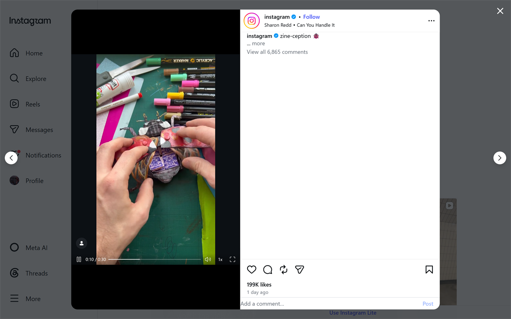

# Instagram Video Control

A minimal, high-performance browser extension that equips Instagram web videos and Reels with a full-featured playback control bar: timeline scrubber, persistent volume control, variable playback speeds, and auto-pause synchronization.

[](manifest.json)
[](https://learn.microsoft.com/en-us/microsoft-edge/extensions/)
[](LICENSE)
[-success)](#architecture)

<p align="center">
  
</p>

---

## Features

- **Seek Timeline Scrubber**: Smooth, responsive dragging to seek through any Instagram video or Reel with real-time current/total duration indicators (`mm:ss`).
- **Persistent Volume Memory**: Remembers your preferred volume level and mute state across videos, reels, and browser restarts using local storage.
- **Dynamic Speaker Icons**: Automatically updates volume icons (Muted, Low, Medium, High) based on audio levels using official Lucide vector paths.
- **Playback Speed Selector**: Instant speed controls supporting `0.5x`, `0.75x`, `1x`, `1.25x`, `1.5x`, and `2x` playback rates.
- **Viewport Visibility Auto-Pause**: Mirrors Instagram's native 50% viewport threshold to pause playback automatically when scrolled away and resume when brought back into focus.
- **Fullscreen Mode**: One-click native video fullscreen toggle with automated control-bar auto-hide on cursor idle.
- **Zero Remote Code & Trackers**: 100% private and client-side. No analytics, no telemetry, no network calls, and no cookies accessed.

---

## Installation

### Developer Mode (Edge / Chrome / Brave / Opera)

1. Clone this repository:
   ```bash
   git clone https://git.skp.my.id/surya/instagram-video-control.git
   ```
2. Open the extension manager in your browser:
   - **Microsoft Edge**: Navigate to `edge://extensions`
   - **Google Chrome / Chromium**: Navigate to `chrome://extensions`
3. Toggle on **Developer mode** (top-right or bottom-left).
4. Click **Load unpacked** and select the cloned `instagram-video-control` directory.
5. Open [instagram.com](https://www.instagram.com) and start playing any video post or Reel.

---

## Architecture

Built with a clean, single-script content architecture adhering to modern Manifest V3 standards:

```text
instagram-video-control/
├── manifest.json         # Extension Manifest V3 configuration
├── service-worker.js     # Background worker for automatic tab injection
├── icons/                # High-res extension icons (16px, 48px, 128px)
├── content/
│   ├── content.js        # Core controller: DOM observer, timeline, volume, speeds
│   └── content.css       # Control bar layout, transitions, and slider styles
├── PRIVACY.md            # Privacy Policy
├── LICENSE               # MIT License
└── README.md
```

- **MutationObserver**: Monitors dynamic DOM mutations to attach controls seamlessly to freshly loaded videos or virtualized feeds without layout shifts.
- **Passive Listeners & RequestAnimationFrame**: Smooth timeline scrubbing and minimal CPU idle overhead.
- **Lucide Icons**: Built-in SVG vector paths; zero external web font or asset loading.

---

## Permissions & Privacy

This extension requests only the minimum host and API permissions strictly necessary:

| Permission | Justification |
| :--- | :--- |
| `storage` | Saves your volume level, mute state, and speed preference locally via `chrome.storage.local`. |
| `scripting` | Injects controls into already-open Instagram tabs when the extension is updated or installed. |
| `*://*.instagram.com/*` | Restricts script execution exclusively to Instagram web domains. |

Read the full [Privacy Policy](PRIVACY.md).

---

## Building Store Package

To package the extension for Microsoft Edge Add-ons or Chrome Web Store submission:

```powershell
Compress-Archive -Path manifest.json, service-worker.js, icons, content -DestinationPath .\instagram-video-control.zip -Force
```

---

## Disclaimer

This is an independent open-source project created by Surya Kencana Putra. This extension is not affiliated with, endorsed by, or sponsored by Instagram, Meta Platforms, Inc., or any of their affiliates.

---

## License

Distributed under the [MIT License](LICENSE). Copyright (c) 2026 Surya Kencana Putra.
